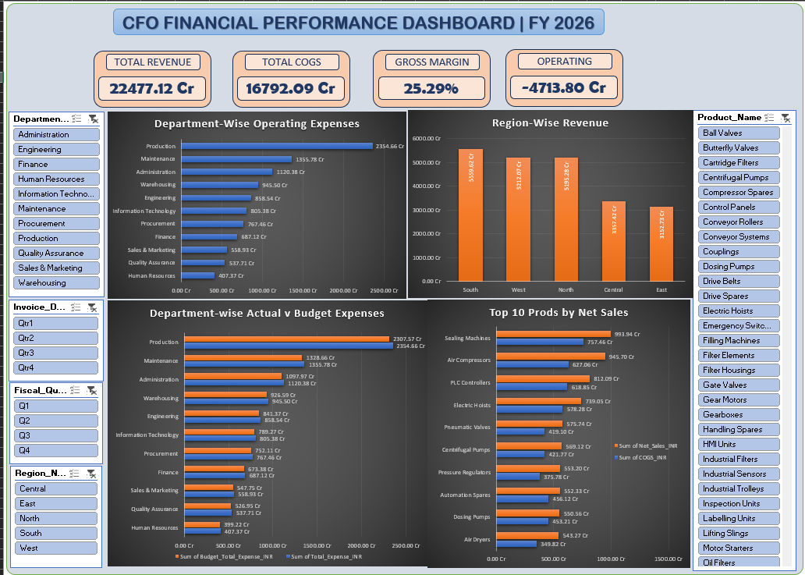

# Corporate Financial Planning & Profitability Analysis

> A practice project focused on financial analysis, profitability, budget tracking, scenario modelling, and executive reporting using Microsoft Excel.

---

## Project Overview

This project simulates a corporate financial planning and profitability analysis workflow. It consolidates departmental data, evaluates financial performance, analyses profitability, tracks budget variances, and models different business scenarios to support management decision-making.

## Project Objectives

- Consolidate departmental financial datasets.
- Perform product-level and departmental profitability analysis.
- Analyse actual vs. budget performance.
- Identify expense overruns.
- Develop financial scenarios.
- Evaluate the impact of raw material price increases.
- Build a CFO-focused financial dashboard.

## Dashboard Preview

---

## Important: Power Query Connections

The Excel workbook uses Power Query to import and transform data from the source Excel files.

After downloading or cloning this repository, the Power Query source paths may need to be updated to match the location of the project folder on your local machine.

To restore data refresh functionality:

1. Open `CFO_Master_Model.xlsx` in Excel.
2. Go to **Data → Queries & Connections**.
3. Edit the source paths of the relevant Power Query queries to point to the files in `Data/Source_Files/`.
4. Refresh the queries.

The workbook's data transformations and analytical model are designed to work with the provided source files.

---

## AI Integration – LM Studio & Qwen

This project includes VBA-based integration with a locally hosted Large Language Model using LM Studio.

### Requirements

- LM Studio installed locally.
- The required Qwen model downloaded in LM Studio.
- The Qwen model loaded and running in LM Studio.
- The local AI server enabled and running.
- Excel macros enabled for the VBA functionality.

**The AI integration will not work unless the required Qwen model is loaded and running in LM Studio.**

The AI integration is designed to assist with analytical interpretation and reporting using locally hosted AI capabilities.

---

## Project Classification

| Attribute | Details |
|---|---|
| Project Type | Practice Project |
| Domain | Data Analytics / Financial Analysis |
| Primary Tool | Microsoft Excel |
| ETL | Power Query |
| Automation | VBA |
| AI Integration | LM Studio with locally hosted Qwen LLM |

---

## Limitations

- Power Query source paths may require updating on the reviewer's local machine.
- Data refresh functionality requires the provided source files and correctly configured source paths.
- VBA functionality requires macros to be enabled.
- AI functionality requires LM Studio, with the required Qwen model loaded and running locally.
- Financial scenarios are assumption-driven and should not be interpreted as actual forecasts.
- Financial outputs are subject to the limitations and assumptions of the underlying datasets and analytical model.

---

## Disclaimer

This is a practice project developed for educational and analytical purposes.

The datasets and financial outputs are fictional and are not intended to represent the actual financial performance of any real company. The analysis should not be interpreted as professional financial, investment, or business advice.
